# Storytelling

_12/10/26 · with Sabrina Calvo & Douglas Edric Stanley_

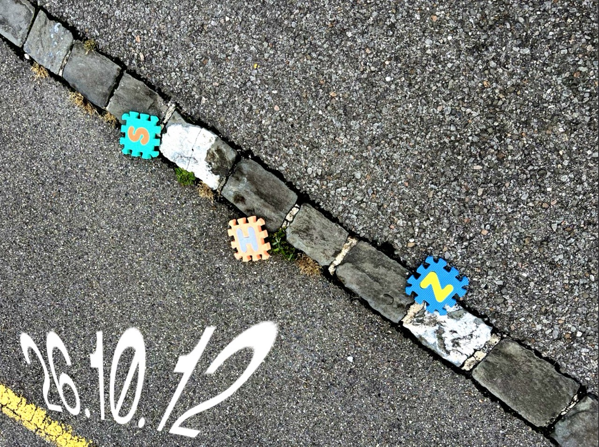

## <u>NARRATION</u>

→ faire connaître - racconter

Good storytelling takes us through the journey of transformation. 
[kishotenketsu](https://fr.wikipedia.org/wiki/Kish%C5%8Dtenketsu): 

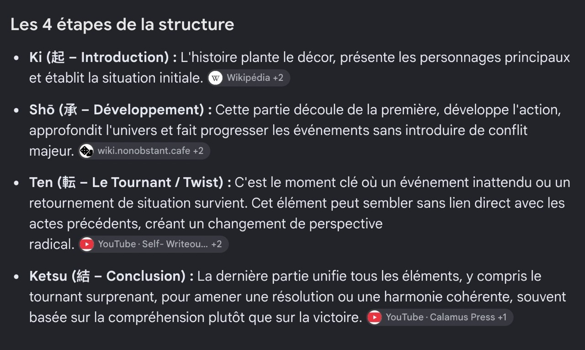
exemples: <u>Totoro !</u> 

WHO / WHAT / WHERE / WHEN / WHY / HOW ???

1. WORLD → Where / When
2. Personnage → Who / Why(?)
3. Intrigue / Plot → What / How

→ Typically, in the classic structure, one of these questions is deliberately left vague in order to develop the narrative around it (Why?).

(World - Persona - Plot)

## <u>Worldbuilding</u>

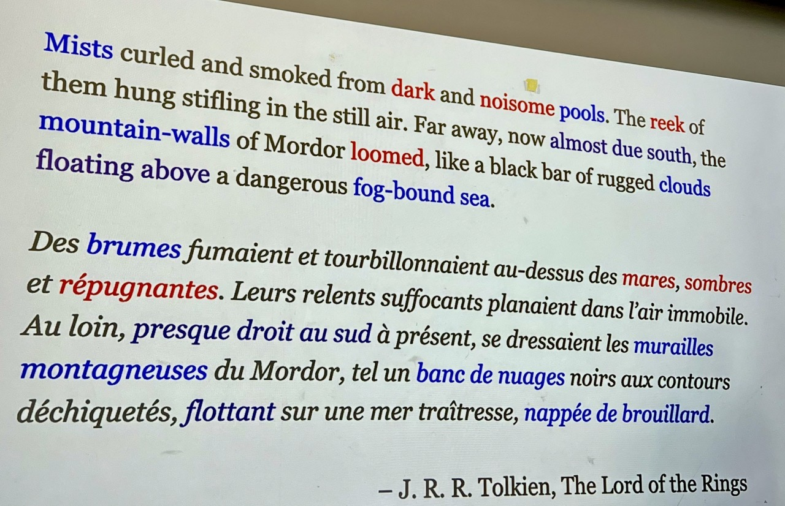

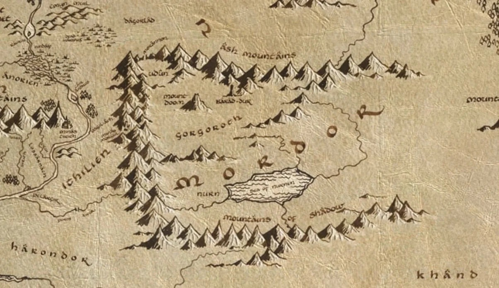

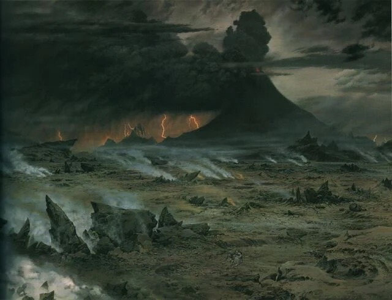

→ How a simple description leads to a multitude of complex representations. 
→ How to reduce a story or a world to its simplest form.
 
→ The reader contract → Provide as little as possible so that the reader builds the world with their imagination.

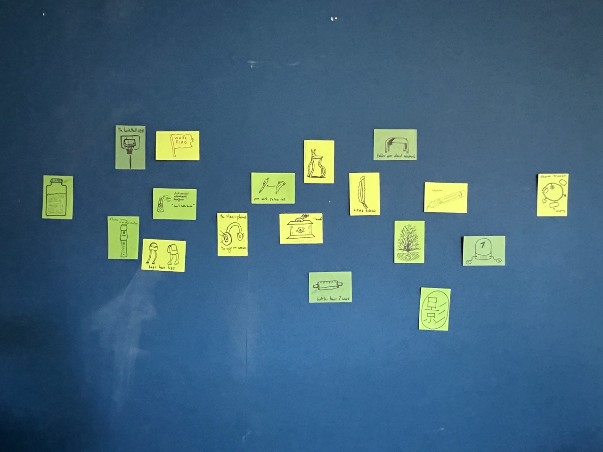

[exercice 1: Design a prop with: minimal departure / outlier / Novum /Synecdoche]

## <u>Persona - Character</u>

A character must have a clear intention. 
Obstacles, desires, needs, etc., make it possible to understand a character's intention. 

The character's behavior provides the information needed to understand them without the need for explanation. → show, don't tell !!! ( exemple: [Crankin's time travel adventure](https://play.date/games/crankin/) ) 

<u>→ All you have is a hammer - all looks like a nail !</u>

Watch out for tropes/clichés!!!
 **[→ Tropes vs women in video games](https://www.youtube.com/playlist?list=PLn4ob_5_ttEaA_vc8F3fjzE62esf9yP61)**

**In our context, the concept of internal conflict is central to harassment.**

[Achilles' heel — the very reason for its power is the source of its weakness.] 
<u> → Oxymore / A good character is contradictory. </u>
→ [excellent example](https://www.youtube.com/watch?v=1R42mFx3_ss)

STASIS vs CHANGE

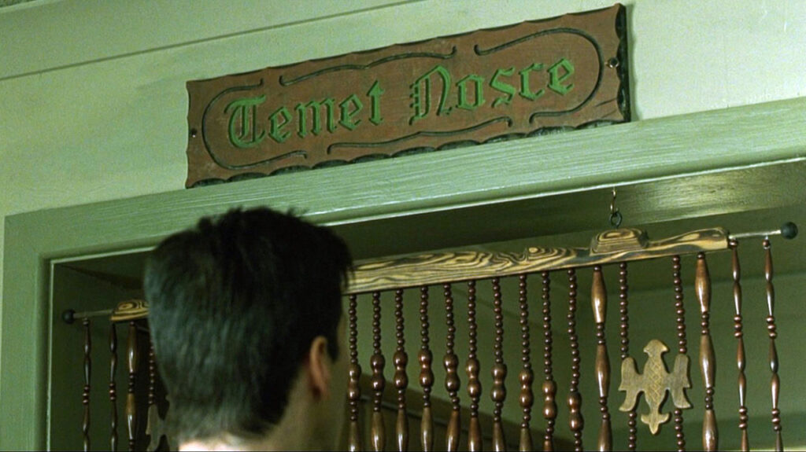
<i>know thyself</i>

**restorative nostalgia vs reflective nostalgia**

## Exercice 2

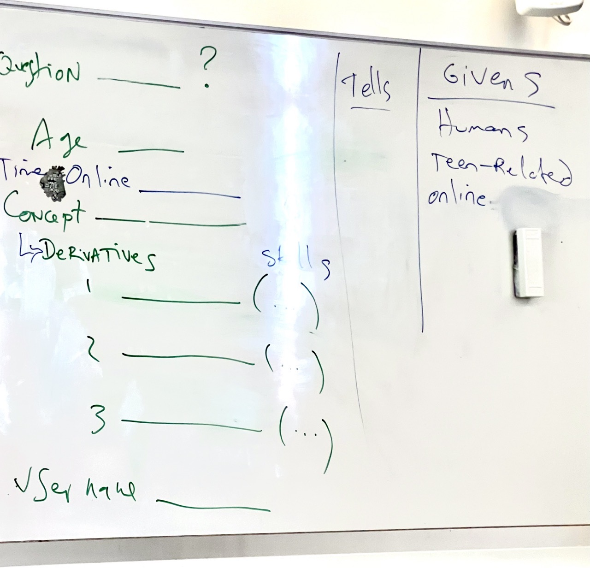
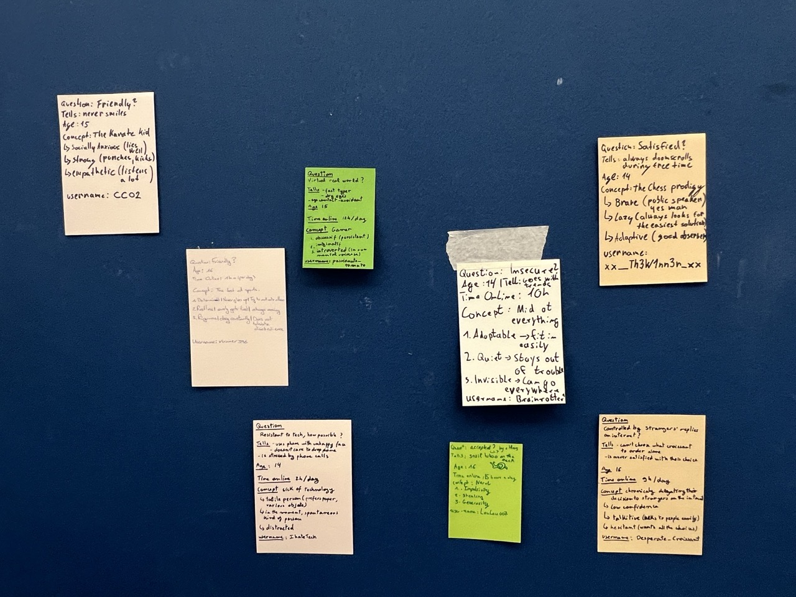
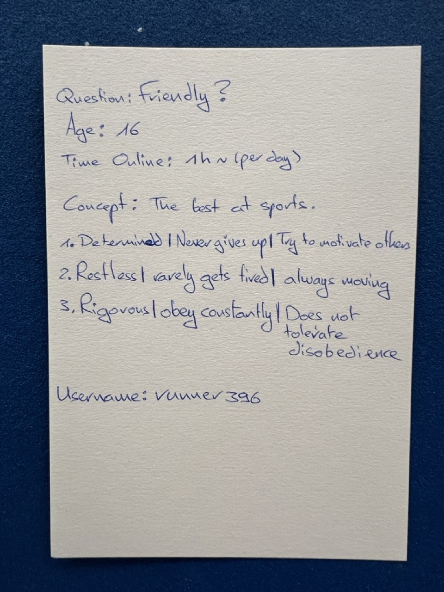

## Handwritten notes

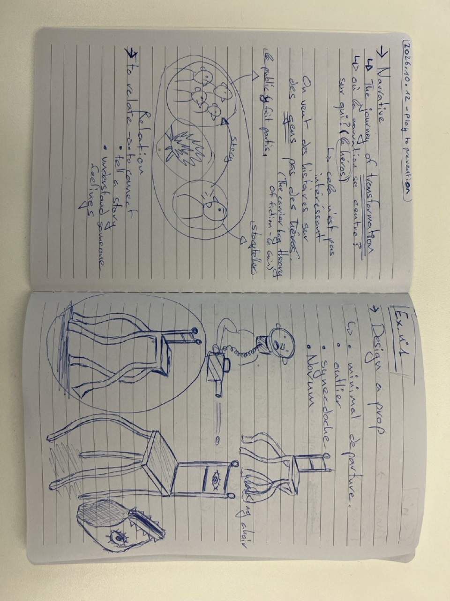
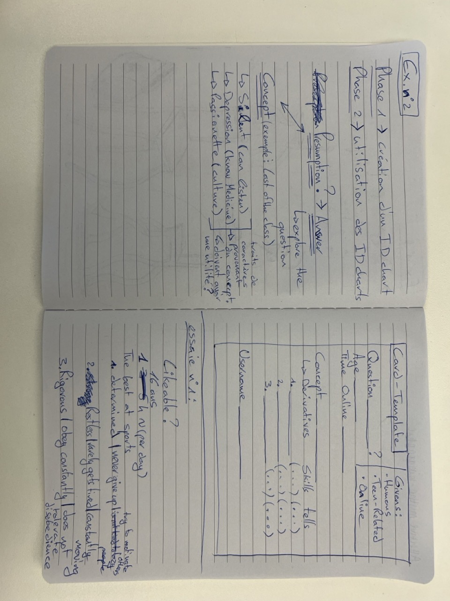

## REF:

- [Morphology of the folktale](https://monoskop.org/images/f/f3/Propp_Vladimir_Morphology_of_the_Folktale_2nd_ed.pdf)
- [The carrier bag theory of fiction](https://communityofwriters.org/wp-content/uploads/2024/01/The-Carrier-Bag-Theory-of-Fiction.pdf)
- [Possible worlds theory](https://en.wikipedia.org/wiki/Possible_world)
- [Possible Worlds, Artificial Intelligence, and Narrative Theory](https://luisnavarrete.com/USC/pdf/Marie_Laure_Ryan.pdf)
- [Six Walks in the Fictional Woods](https://en.wikipedia.org/wiki/Six_Walks_in_the_Fictional_Woods)
-

<!-- nav:footer -->

---

↑ [Home](../README.md) · [M](README.md)  
Linked from: [Sweet Dreams, pitch](../R/26-11-02_sweet-dreams-pitch.md)

<!-- /nav:footer -->
